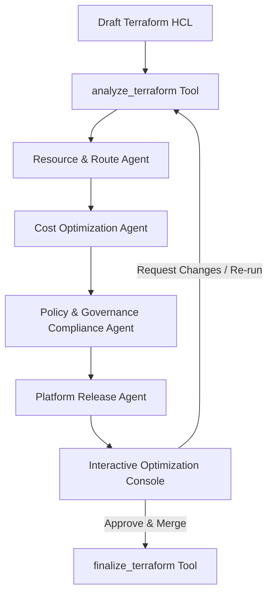

# CloudOps OS: Autonomous Multi-Agent Governance and Optimization for IaC

CloudOps OS is a fully autonomous multi-agent orchestration pipeline that shifts cloud governance and cost optimization entirely to the left. Deployed as Model Context Protocol (MCP) servers using NitroStack, the system ingests raw Terraform (.tf) files alongside natural language user intent, passing them through a strict four-stage reasoning engine.

Each agent operates sequentially through a strict **Flag ➔ Explain ➔ Diagnose ➔ Resolve** cycle.
THIS IS STILL ON A DEVELOPING STAGE
---

## 🚀 Key Features

- **⚙️ Phase 1: Resource & Route Optimization Agent (FinOps)**
  - Flags network routing tax, explaining the $0.045/GB NAT Gateway data transfer and hourly base overhead.
  - Injects free AWS VPC S3/DynamoDB Gateway Endpoints into the HCL to eliminate routing charges.

- **💰 Phase 2: Cost Optimization Agent**
  - Flags over-provisioned compute capacity (`m5.large`) and legacy storage types (`gp2`).
  - Rightsizes EC2 instances to burstable tiers (`t3.medium`) and upgrades volumes from gp2 ($0.10/GB-mo) to gp3 ($0.08/GB-mo + 3000 free IOPS), reducing baseline storage costs by 20% and improving performance.
  - Computes strategic costing alternatives (Spot instances and Instance Scheduling policies).

- **🛡️ Phase 3: Policy & Governance Compliance Agent**
  - Identifies contractual and operational anomalies, such as unauthorized regions (`us-west-1` prohibited by Service Control Policies) and exposed ingress CIDR blocks (port 22 open to `0.0.0.0/0`).
  - Explains the specific SLA/SCP violations, auto-remediating HCL to `us-east-1` and corporate intranet limits (`10.0.0.0/8`).
  - Appends mandatory tags (`Environment`, `Compliance`, `Owner`) for audit readiness.

- **🚀 Phase 4: Platform Release Agent**
  - Performs syntax validation (`fmt` and `validate`) and bracket matching.
  - Simulates plan execution states and compiles final output blocks.

- **📜 Stage 3b: Policy-as-Code (.rego / OPA) Pass**
  - `analyze_terraform` accepts an optional `rego_policy` input — a real Open Policy Agent `.rego` document (see `policies/governance.rego`).
  - Evaluated with the real `opa` CLI when it's on `PATH`; otherwise falls back to a transparent, dependency-free "rego-lite" interpreter bundled in `src/modules/terraform/policy.engine.ts`. Every finding is tagged with `source: 'opa' | 'rego-lite-fallback'` so the console never overstates the guarantee.
  - Lets platform teams change governance rules without touching TypeScript — the deterministic engine stays as the reliable baseline, `.rego` adds org-specific policy on top.

- **🧠 Stage 5: Optional LLM Reasoning Agent**
  - `src/modules/terraform/llm.agent.ts` calls OpenRouter (or Groq as a secondary provider) to look for issues the deterministic + rego passes can't encode — naming smells, missing `lifecycle{}` blocks, intent gaps between reviewer instructions and code.
  - Provider chain: `OPENROUTER_API_KEY` → `GROQ_API_KEY` → disabled. Never blocks or fails the pipeline — a missing key or a failed call degrades to a single log line, and the deterministic + rego findings are returned regardless.
  - Every LLM-sourced diagnostic carries `source: 'llm'` and a `confidence` score self-reported by the model.

- **💬 Explainable AI (XAI) Console**
  - Streams real-time diagnostic reasoning showing precisely what was flagged, why it represents a violation, what audit controls are violated, and how the code was resolved.
  - Every diagnostic now carries `source` (`deterministic` / `opa` / `rego-lite-fallback` / `llm`) and `confidence`, so reviewers can see *which engine* made each claim, not just the claim itself.

- **🔒 Zero-Trust Human-in-the-Loop (HITL) Console Widget**
  - Side-by-side HCL diff viewer highlighting modifications.
  - XAI Disclosures popover panel demonstrating the Flag ➔ Explain ➔ Diagnose ➔ Resolve reasoning on clicked diffs.
  - Strategic cost savings ledger and custom override re-runs (e.g. typing `"use spot pricing"` automatically updates the setup).
  - One-click approval to finalize and simulate deployment.

---

## 📐 Architecture & Agent Pipeline



---

## 🛠️ Installation & Setup

Ensure your local development environment meets the following requirements:
- **Node.js** (v18+)
- **NPM** (v9+)
- **TypeScript** (v5+)

### 1. Install Project Dependencies
Clone the repository and install all packages:
```bash
npm run install:all
```

### 2. Run the Project in Development Mode
Start both the MCP server and hot-reloaded Next.js widgets server:
```bash
npm run dev
```

### 3. Setup .env file
Create a `.env` file in the root to enable dual SSE/STDIO transport on port 3000:
```env
PORT=3000
MCP_TRANSPORT_TYPE=dual
NITRO_LOG_LEVEL=info
NITROSTACK_APP_MODE=universal
```

---

## 💻 Usage & Demo Instructions

In your MCP client, invoke the `analyze_terraform` tool. If you leave the payload empty, it automatically defaults to our standard sandbox template containing all 5 violations:

### Default Draft Input HCL:
```hcl
provider "aws" {
  region = "us-west-1" # Region Violation
}

resource "aws_security_group" "web_sg" {
  name   = "web-server-sg"
  ingress {
    from_port   = 22
    to_port     = 22
    protocol    = "tcp"
    cidr_blocks = ["0.0.0.0/0"] # Port 22 Violation
  }
}

resource "aws_instance" "web_app" {
  ami           = "ami-0c55b159cbfafe1f0"
  instance_type = "m5.large" # Sizing Violation

  ebs_block_device {
    device_name = "/dev/sda1"
    volume_size = 100
    volume_type = "gp2" # Storage Violation
  }
}

resource "aws_nat_gateway" "nat" {
  allocation_id = "eipalloc-12345"
  subnet_id     = "subnet-6789a" # NAT Routing Violation
}
```

### Reviewing Widget Flow:
1. **Visual Diff**: Inspect highlights (red deletions/green additions) showing the region fix, SSH range contraction, instance downgrade, storage tier upgrade, and NAT Gateway replacement.
2. **XAI Disclosures**: Click any modified line to open the popover, displaying the exact **Flagged Anomaly, Explain (The Why), Diagnosis, and Resolved Code**.
3. **Live Costing Ledgers**: Review compute and networking savings alongside the 20% storage cost reduction.
4. **HITL Re-runs**: Type `use spot pricing` in the override box and click **Request Changes** to inject Spot market configurations live.
5. **Approve & Commit**: Click **Approve & Save Changes** to merge, generate git commit references, and output simulated CLI deploy logs.

---

## 🧪 Testing & Quality Assurance

Run unit and integration test suites:
```bash
npm test                # Run Jest test suite
npm run test:coverage   # Generate test coverage reports
npm run typecheck       # Verify TypeScript static types
```

